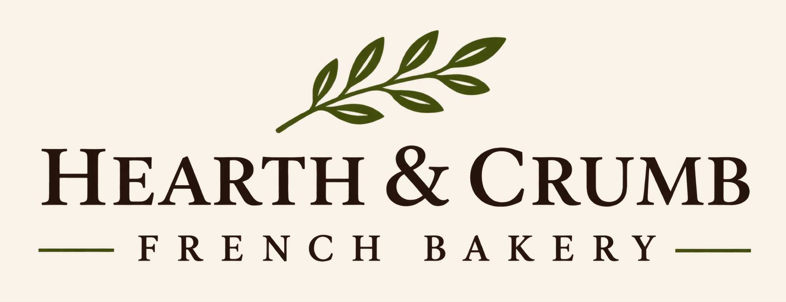
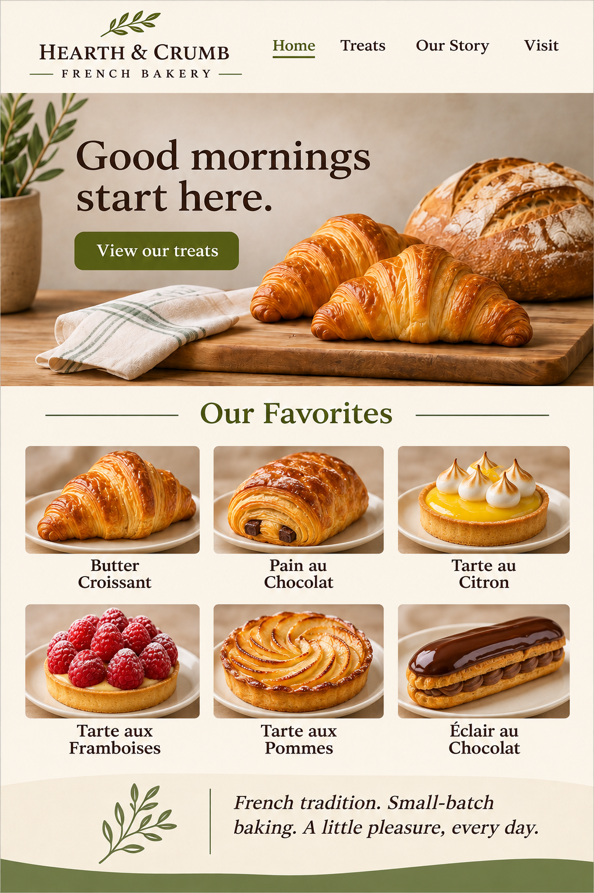

# Hearth & Crumb French Bakery — artwork

Fictional bakery sample for Spud Films. Updated November 25, 2026.

## Downloads

| Artwork | File |
| --- | --- |
| French bakery homepage mockup | [homepage.png](homepage.png) |
| Transparent logo for video/image overlays | [logo-transparent.png](logo-transparent.png) |
| Logo on matching cream | [logo-cream.png](logo-cream.png) |
| Transparent logo PDF | [logo-transparent.pdf](logo-transparent.pdf) |
| Cream logo PDF | [logo-cream.pdf](logo-cream.pdf) |

All logos read **Hearth & Crumb — French Bakery**. The PNG logos are 2021 × 778 pixels. The PDFs preserve the same raster artwork, rather than editable vector lettering. The transparent PDF has no opaque page background; some PDF viewers display a white page behind transparent content.

Cream background sampled from the new homepage header: **#FAF3E8**.

Use the transparent PNG for compositing in a video editor. On GitHub, open a file and choose **Download raw file** to save the original.

## Previews

## Homepage products

Butter croissant, pain au chocolat, tarte au citron, tarte aux framboises, tarte aux pommes, and éclair au chocolat.

The new French bakery source mockup is saved here. The existing website image and page code are separate files.

See the [video concept](../../docs/hearth-and-crumb-video.md) for the current ad plan.
